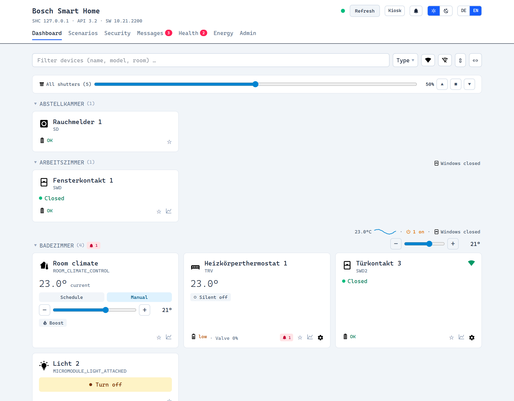
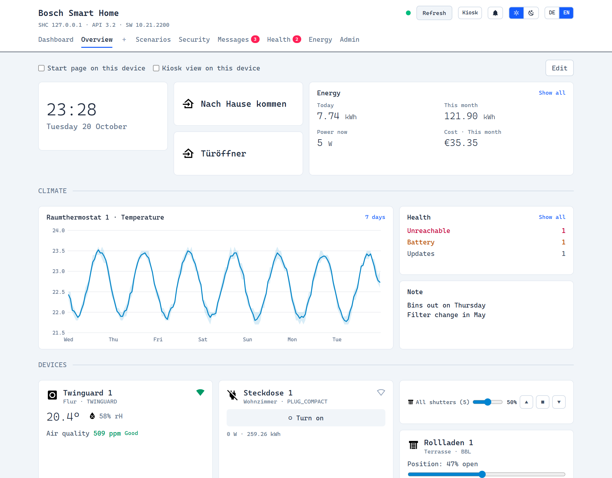
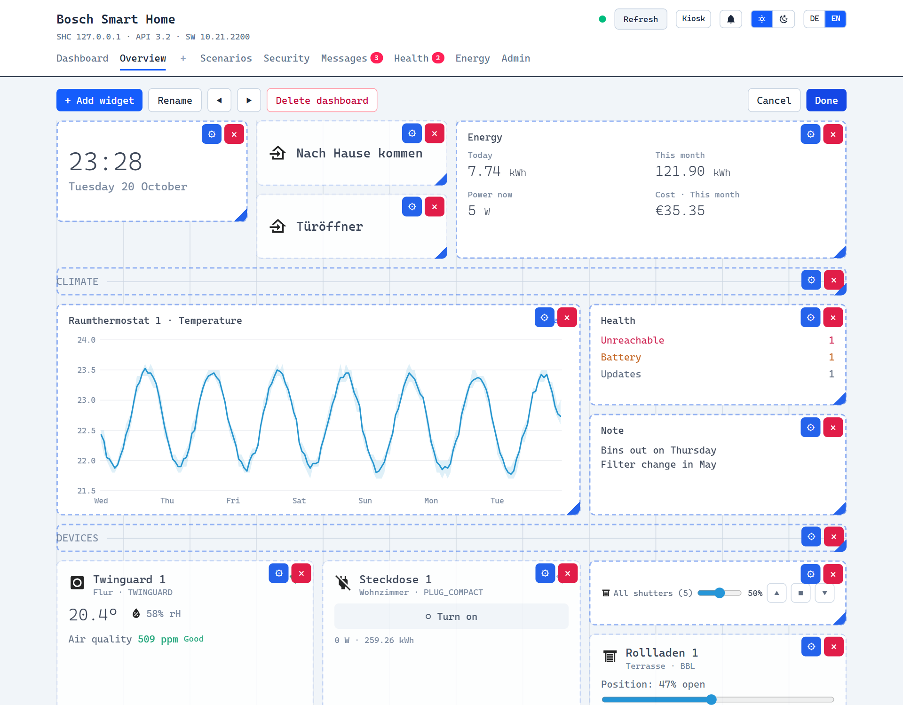
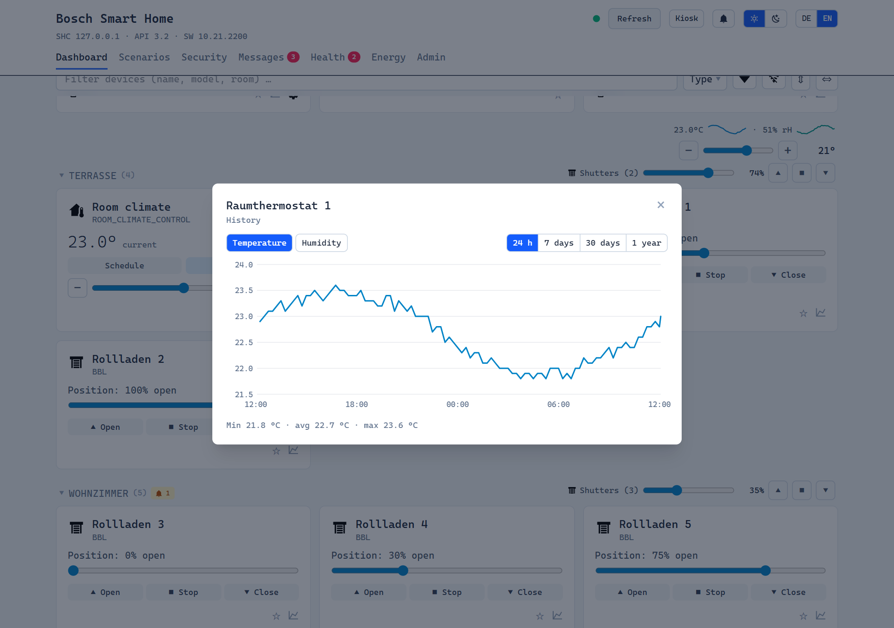
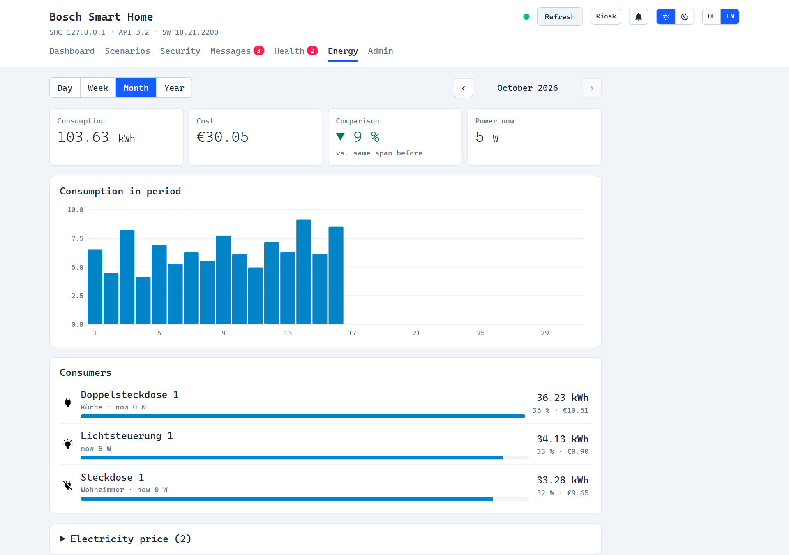
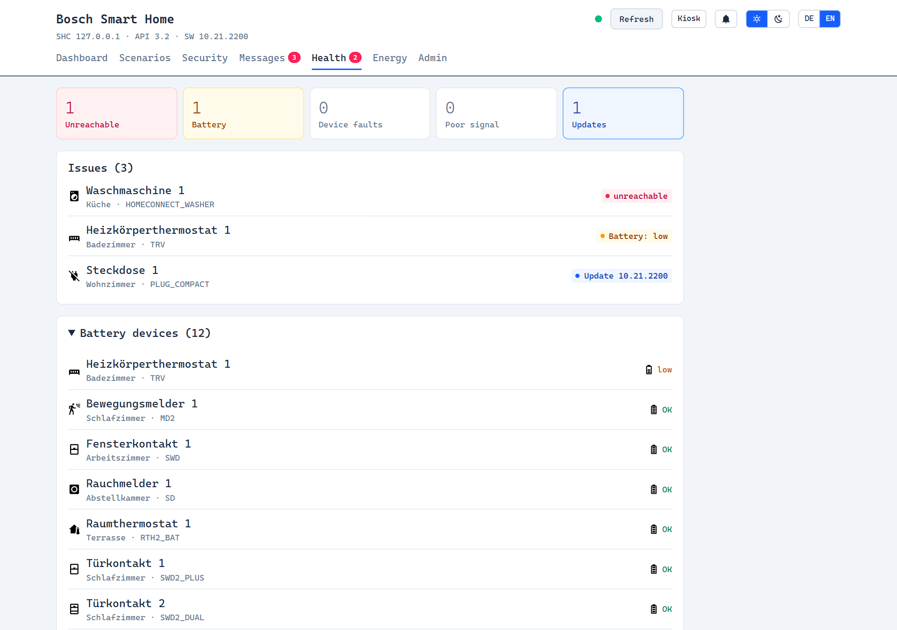
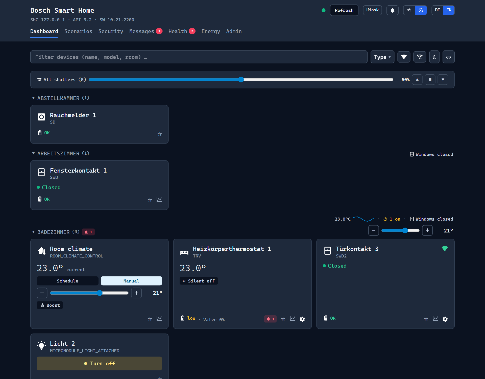
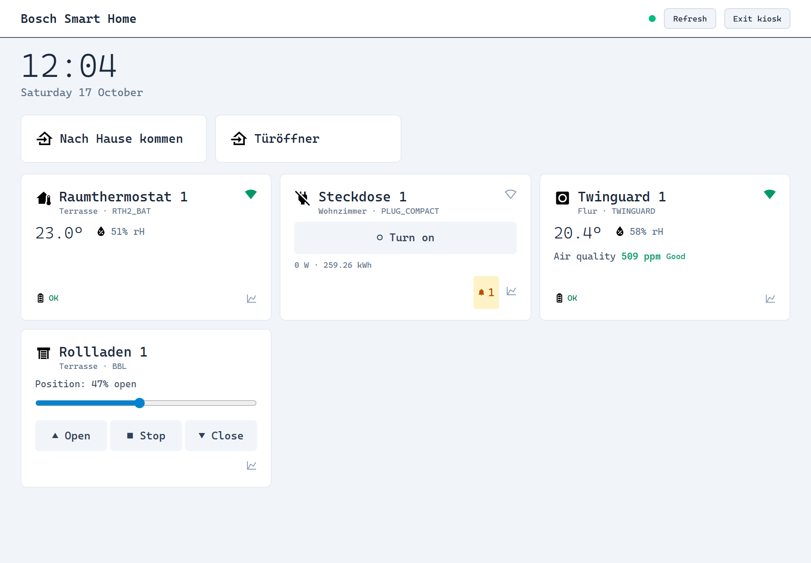
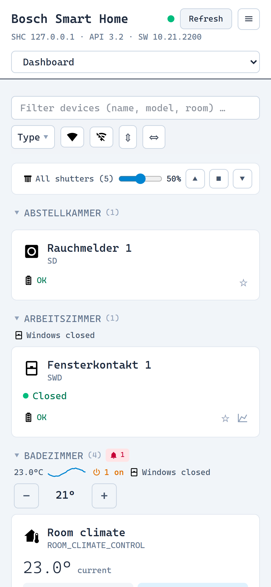

# Bosch SHC Web UI

**A fast, local web interface and dashboard for the Bosch Smart Home Controller (SHC I and II)** — control every device from any browser, see history charts and energy costs, and keep an eye on batteries and signal quality. An open-source alternative to the Bosch Smart Home app for desktop, tablet and wall panels. Runs entirely in your home network, no cloud. Install as a **Home Assistant add-on**, with **Docker** or plain **Node.js**. English and German.

**Website:** [benjenjones.github.io/bosch-shc-web-ui](https://benjenjones.github.io/bosch-shc-web-ui/)



> **Auf Deutsch:** Lokale Weboberfläche für den Bosch Smart Home Controller – alle Geräte im Browser steuern, Verlaufsdiagramme für Temperatur und Luftfeuchtigkeit, Stromverbrauch und -kosten, Batterie- und Funkstatus. Ohne Cloud, als Home-Assistant-Add-on, Docker-Container oder mit Node.js. Die Oberfläche gibt es komplett auf Deutsch.

## Highlights

- **Dashboard** — all devices by room: heating, shutters, lights, plugs, contacts, smoke and motion detectors, Twinguard, cameras. Live updates without reloading.
- **History charts** — temperature, humidity, power, valve position, air quality and more, from 24 hours to a year. Includes values the Bosch app doesn't show.
- **Energy** — consumption and cost per day, week, month and year, per device, with your own electricity price.
- **Health** — unreachable devices, low batteries, weak signal and pending firmware updates at a glance.
- **Custom dashboards** — build your own pages from widgets (devices, rooms, charts, energy, health, scenario buttons, clock, notes, …) and arrange them by drag & drop. Each one gets its own tab; pick one as start page or for the kiosk view per device.
- **Favourites & kiosk mode** — a clean wall-tablet view with just the devices and scenarios you need, or one of your dashboards.
- **Scenarios, automations, alarm system, messages** — run, switch and arm from the browser.
- **Install as an app** on phone or desktop (PWA), optional login with multiple users, light and dark theme.

| Custom dashboard | Dashboard editor | History |
| --- | --- | --- |
| [](docs/img/custom-dashboard.png) | [](docs/img/dashboard-editor.png) | [](docs/img/history.png) |
| **Energy** | **Health** | |
| [](docs/img/energy.png) | [](docs/img/health.png) | |
| **Dark theme** | **Kiosk** | **Mobile** |
| [](docs/img/dashboard-dark.png) | [](docs/img/kiosk.png) | [](docs/img/mobile.png) |

## Installation

You need a Bosch Smart Home Controller (I or II), already set up in the Bosch app, and its **system password**. Choose one way to run the UI:

| You have … | Install |
| --- | --- |
| **Home Assistant** | Add-on store → ⋮ → Repositories → add `https://github.com/BenjenJones/bosch-shc-web-ui` → install **Bosch SHC Web UI** |
| **Docker** (NAS, server, Raspberry Pi) | `docker run -d --name bosch-shc-ui --restart unless-stopped -p 3000:3000 -v bosch-shc-data:/data ghcr.io/benjenjones/bosch-shc-web-ui:latest` |
| **Node.js** (Linux, Windows, macOS) | clone the repo, `npm ci`, `npm start` |

**Step-by-step guides** — including Synology, Unraid, Portainer, a Raspberry Pi service, Windows autostart, updates and backups — are in **[docs/INSTALL.md](docs/INSTALL.md)**.

Then open `http://<ip>:3000`. A short wizard pairs the UI with your controller: enter its IP, press the button on the SHC, type the system password, done.

### Updating

| Install | Update |
| --- | --- |
| Home Assistant | shown under *Settings → Updates* |
| Docker Compose | `docker compose pull && docker compose up -d` |
| Node.js | `git pull && npm ci && npm run build:css`, then restart |

The UI shows an **Update** badge next to its title when a new version is out ([details and opt-out](docs/INSTALL.md#update-notifications)). What changed: [CHANGELOG.md](CHANGELOG.md).

### Just looking?

Try the demo with made-up devices and a year of history — no controller needed:

```bash
docker run --rm -p 3001:3001 ghcr.io/benjenjones/bosch-shc-web-ui node demo.js
# or, with Node.js and the repo: npm install && npm run demo
```

Then open `http://localhost:3001`.

## Features in detail

<details>
<summary><b>Dashboard</b></summary>

- Devices grouped by room, with collapsible room sections
- Filter bar (search by name, model, room), device type filter, expand/collapse-all
- Room header: temperature and humidity with 24 h sparklines, devices switched on, open windows, heating setpoint
- Switchable plugs and lights (dimming and colour where supported)
- Room climate: setpoint, schedule vs. manual, boost, heating pause on open windows
- Temperature, humidity, window/door contacts, power consumption, battery status, signal quality
- Grouped shutter control per room and for all shutters
- Twinguard: air quality, temperature, humidity
- Camera controls: privacy mode, push notifications, light
- Bell with the device's active messages
- **Live updates** via the SHC's long polling
</details>

<details>
<summary><b>Custom dashboards</b></summary>

- Build your own pages from widgets: device, room (with climate and shutters), history chart, energy (today, month, power now, cost), health, messages, alarm system, scenario button, all shutters, clock, text/note and divider
- Free grid with drag & drop: move widgets, resize them from the corner, others make room
- Each dashboard gets its own tab with its own name; **+** in the tab bar adds one
- Created and edited by admins (by anyone when login is off); everyone sees the same dashboards — stored on the server (`dashboards.json` in the data folder)
- Per device: use a dashboard as the start page and/or as the kiosk view (`?kiosk=<dashboard id>` also works)
- On phones the widgets stack in reading order
</details>

<details>
<summary><b>History & charts</b></summary>

- Records temperature, humidity, setpoint, power, energy counter, window/door contacts, valve position, air quality, shutter position and illuminance — from live events plus a snapshot every 15 minutes
- Chart on each device card: 24 h / 7 days / 30 days / 1 year, min/max band, setpoint overlay, crosshair tooltip; energy as consumption bars
- Retention configurable under *Admin → History*: individual values (default 14 days), hourly values (730 days), daily values (unlimited)
- Stored locally in SQLite (`history.sqlite` in the data folder)
</details>

<details>
<summary><b>Energy</b></summary>

- Consumption of all metering devices per day / week / month / year, browsable back in time
- Tiles: consumption, cost, comparison with the previous period, current total power
- Consumption chart and a ranking of all consumers with share and cost
- Electricity price per kWh with a *valid from* date — add a row when the tariff changes
</details>

<details>
<summary><b>Health</b></summary>

- Summary tiles: unreachable devices, battery, device faults, poor signal, firmware updates — click to filter
- Issue list sorted by severity
- All battery-powered devices and all devices' signal quality, worst first
- Tab badge with the number of devices that need attention
</details>

<details>
<summary><b>Favourites & kiosk</b></summary>

- Pin devices and scenarios with ☆ — they appear at the top of the dashboard. Stored per browser, so each tablet/phone keeps its own selection
- *Kiosk* (header button, or open the UI with `?kiosk`): clock plus favourites only — or a custom dashboard chosen for this device — larger touch targets; keeps the screen awake where supported
</details>

<details>
<summary><b>Scenarios, automations, security, messages</b></summary>

- Run scenarios, enable/disable and edit automations, toggle user-defined states
- Arm / disarm the alarm system (full, partial, custom), mute an active alarm
- Messages with translated titles, severity, source device, dismissal, archive and optional browser notifications
- Universal switch / Twist button assignments
</details>

<details>
<summary><b>Admin & users</b></summary>

- Controller overview with firmware and update status, re-pairing
- Manage paired clients, rename rooms, rename or remove devices, inspect raw device JSON
- Optional login, switched on or off under *Admin → Login* at any time: admin creates users, resets passwords, sees and revokes sessions. Passwords are stored as scrypt hashes
- Regular users see the dashboard, scenarios, security and messages
</details>

<details>
<summary><b>Install as app (PWA)</b></summary>

- "Install app" / "Add to Home Screen" gives the UI its own window and icon
- Needs a **secure context**: `https://` with a certificate the device trusts (see [HTTPS](#https)), the Home Assistant add-on via HA's URL, or `localhost`. Over plain `http://<ip>:3000` everything else works, just without install
</details>

## HTTPS

By default the UI is served over plain HTTP. Two ways to add TLS:

**Native HTTPS.** Point `config.json` (in the data folder) at a certificate:

```json
"uiTls": { "certPath": "certs/ui-cert.pem", "keyPath": "certs/ui-key.pem" }
```

Paths may be relative to the project folder or absolute. A self-signed certificate works but browsers warn and won't allow installing the app:

```bash
openssl req -x509 -newkey rsa:2048 -nodes -days 825 -keyout certs/ui-key.pem -out certs/ui-cert.pem -subj "/CN=shc.home.lan"
```

`uiTls` is independent of the client certificate used for the SHC — don't reuse that one. Don't set `uiTls` in the Home Assistant add-on (ingress expects HTTP).

**Reverse proxy.** Keep the UI on `127.0.0.1:3000` and terminate TLS in front — Caddy is simplest (`reverse_proxy 127.0.0.1:3000`). With Apache/nginx make sure `/api/events` (Server-Sent Events) isn't buffered and the proxy timeout is high (Apache: `ProxyPass / http://127.0.0.1:3000/ flushpackets=on` + `ProxyTimeout 3600`). The UI uses relative URLs only, so sub-paths work.

## Security notes

- The files in `certs/` are your key to the SHC — don't share them.
- Without login, anyone who can reach port 3000 can switch your devices. Enable login in the wizard (or later under *Admin → Login*) if your network isn't fully trusted, and don't expose the port to the internet.
- `auth.json` holds password hashes and session tokens — treat it like a secret.
- The SHC presents a self-signed certificate, so the connection to it isn't verified against a CA. For a hardened setup, pin Bosch's CAs (published in the official API repo) via the `ca:` option of the `https.Agent` in `server.js`.

## Troubleshooting

| Problem | Possible cause |
| --- | --- |
| Pairing: *registration failed* / `401` | Wrong system password, or the SHC wasn't in pairing mode (LED blinking) — press the button and retry right away |
| Pairing: *certificate generation failed* | Usually the data folder isn't writable — the wizard shows the exact error |
| `EADDRINUSE` on start | Port 3000 is taken — change `uiPort` in `config.json` (Docker: change the left port number) |
| Red banner *"SHC no longer recognises this installation"* / `certificate unknown` | The client was removed in the Bosch app, or the SHC was reset. Use **Re-pair** in the banner or under *Admin → Controller* (keeps users, history, settings) |
| Live indicator stays red | Connection to the SHC lost — check the SHC is online and the server log |
| UI loads but shows no devices | Check `/api/devices` in the browser's developer tools (Network tab) |
| Forgot the admin password | `npm run setup:auth` (Linux service: see [INSTALL.md](docs/INSTALL.md#nodejs-on-linux-raspberry-pi-debian-ubuntu)) — keeps other users and the pairing |
| `503` from the SHC when switching | Usually an unsupported value — open the device's info (ⓘ) under *Admin* to see its actual state |
| Charts missing on a Node install | Node.js older than 22.13 — update Node |

## For developers

Architecture, demo dataset, screenshots, tests and the release process: **[docs/DEVELOPMENT.md](docs/DEVELOPMENT.md)**.

## Disclaimer & license

This is an **unofficial hobby project** with **no affiliation** to Robert Bosch GmbH or Bosch Smart Home GmbH. "Bosch" and "Smart Home Controller" are trademarks of their respective owners. It uses the official [local SHC API](https://github.com/BoschSmartHome/bosch-shc-api-docs), which Bosch permits for **private, non-commercial use** only; the client id `oss_bosch_shc_web_ui` follows Bosch's `oss_…` naming rule. Use at your own risk. Created with the help of AI (Claude Opus 4.7) under the supervision of an experienced software architect.

MIT licensed — see [LICENSE](LICENSE). **Exception:** the OpenAPI specs under [`test/openapi/`](test/openapi/) are verbatim copies of Bosch's API documentation, © Robert Bosch GmbH, licensed under [CC BY-NC-ND 4.0](https://creativecommons.org/licenses/by-nc-nd/4.0/legalcode) and subject to [Bosch's Terms & Conditions](https://github.com/BoschSmartHome/bosch-shc-api-docs#terms-and-conditions); see [`test/openapi/NOTICE.md`](test/openapi/NOTICE.md). They are redistributed for non-commercial use only, as the contract source for the test suite.
