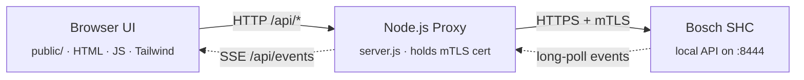

# Development

Notes for working on the code. For installing and running the UI, see the [README](../README.md) and [INSTALL.md](INSTALL.md).

## Architecture



Solid arrows are synchronous request/response, dotted arrows are the live-event channel: `server.js` keeps a long-polling JSON-RPC connection open to the SHC and fans incoming events out to every connected browser via Server-Sent Events.

The proxy is required because browsers cannot present client certificates (mTLS) to third-party hosts — but the SHC requires exactly that.

| Path | What |
| --- | --- |
| `server.js` | Express proxy: SHC requests, auth, setup wizard, SSE, history/energy API, update check |
| `setup.js` | Pairing (certificate + registration) — used by the CLI and the web wizard |
| `history.js` | SQLite history store (`node:sqlite`, Node ≥ 22.13) |
| `public/js/*.js` | Frontend as native ES modules (`main.js` entry, `core.js` shared state, one module per tab) |
| `public/i18n/{de,en}.json` | Translations — add new keys to both |
| `demo/` | Demo SHC + anonymized dataset |
| `bosch-shc-ui/` | Home Assistant add-on manifest |
| `deploy/` | systemd unit |

## Getting started

```bash
npm install
npm run demo        # UI against the demo SHC → http://localhost:3001
npm start           # UI against a real SHC   → http://localhost:3000
npm test            # vitest (API tests run against a Prism mock of the official OpenAPI specs)
```

`npm start` runs a `prestart` hook that compiles Tailwind CSS from `public/tailwind.src.css` into `public/tailwind.css` (gitignored). The CSS is fully self-hosted — no CDN — and tree-shaken to only the utilities the UI actually uses. If you serve `public/` without going through `npm start`, run `npm run build:css` first. `npm run watch:css` rebuilds it on every change so new utility classes show up without restarting the server.

## Demo mode

`npm run demo` starts a self-contained **demo SHC** (`demo/shc-server.js`) that mimics the real controller's `/smarthome/*` HTTP API, then boots the normal UI server pointed at it via a temporary `shcProtocol: 'http'` config — so `server.js` carries no demo-specific code; the abstraction is the HTTP interface itself. It listens on a **separate port (3001 by default, override with `BOSCH_SHC_DEMO_PORT`)** so it can run alongside a real instance on 3000. No real `config.json`, certificates or login are required, and a year of synthetic history is generated on start (`demo/history-seed.js`) so charts and the energy view have data.

Everything is interactive: toggling a plug, moving a setpoint, arming the alarm or renaming a room all persist **in memory** for the lifetime of the process (a restart resets to the dataset on disk, which is never modified).

The demo is also in the container image: `docker run --rm -p 3001:3001 ghcr.io/benjenjones/bosch-shc-web-ui node demo.js`.

### The demo dataset

The committed dataset lives in [`demo/dataset/`](../demo/dataset/) (`devices.json`, `services.json`, `rooms.json`, `scenarios.json`, `automations.json`, `userdefinedstates.json`, `messages.json`, `messages-archive.json`). It is **anonymized and curated** — one device per `deviceModel`, real device/state IDs replaced with deterministic placeholders, device names genericized, free-text push messages scrubbed.

It is generated from real SHC exports placed under `examples/` (which are **gitignored** — they come from a real system and are never committed):

```bash
npm run demo:build
```

Drop your own `examples/devices.json` + `examples/services.json` (and optionally `automations.json` / `scenarios.json`, or the `02_*`-prefixed variants) there, re-run the build, and the dataset regenerates. The service states are borrowed from the real `services.json` as per-service-id templates; `BatteryLevel` carries no state — exactly like a real SHC, which reports low battery only via `faults`.

## Screenshots

```bash
npm run screenshots
```

Boots the demo on port 3091, drives it with `playwright-core` and writes `docs/img/*.png` (dashboard light/dark, history chart, energy, health, kiosk, mobile). Uses your installed Chrome — no browser download. `SCREENSHOT_CHANNEL=msedge` uses Edge; `SCREENSHOT_CHANNEL=chromium` uses Playwright's own Chromium (`npx playwright install chromium` first). `SCREENSHOT_LANG=de` for German screenshots. Re-run after UI changes so the README stays current.

## Extending

The backend proxy (`server.js`) is intentionally thin — adding a new endpoint usually means adding one entry to `GET_ENDPOINTS` or a single new route. The dashboard renders generically from the `services` array; further service types can be added inside `renderDeviceCard()` in `public/js/devices.js`. Device categories (type filter, sort order, icons) live at the top of the same file.

Recorded history metrics are defined in `METRICS` in `history.js`; `SERVICE_METRICS` in `public/js/charts.js` mirrors it.

## Releasing

Versions live in three places that must agree: `package.json` (`version`, shown in the UI and used by the update check), `bosch-shc-ui/config.yaml` (`version`, the image tag the HA add-on pulls) and the git tag. The image workflow refuses to build a tag that doesn't match both files.

```bash
# bump package.json and bosch-shc-ui/config.yaml to 0.1.5, commit, then:
git tag v0.1.5 && git push origin v0.1.5
```

`.github/workflows/build-addon.yml` builds the multi-arch image (`amd64`, `arm64`) and publishes `ghcr.io/benjenjones/bosch-shc-web-ui:0.1.5` and `:latest`. The GHCR package must be **Public** (set once under the repo's *Packages*) so users can pull without authentication.

Running installs notice the new tag within 12 hours (update badge in the header; see `checkForUpdate()` in `server.js`). The HA add-on is excluded — Home Assistant announces add-on updates itself.
